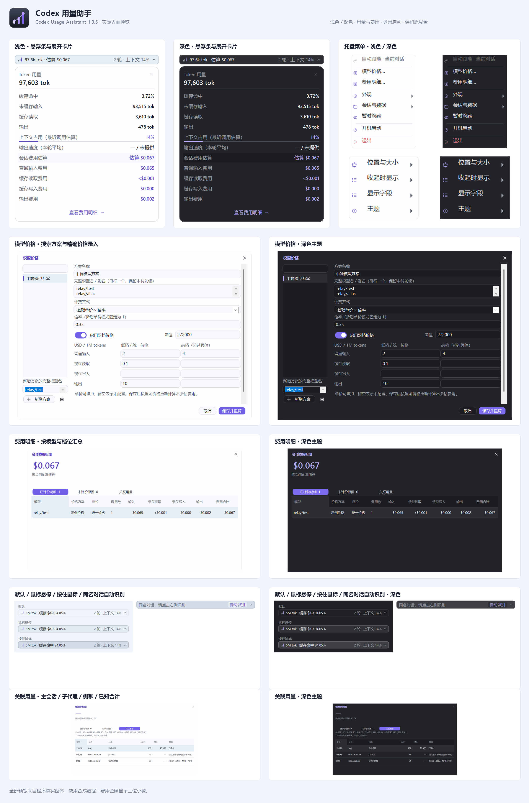
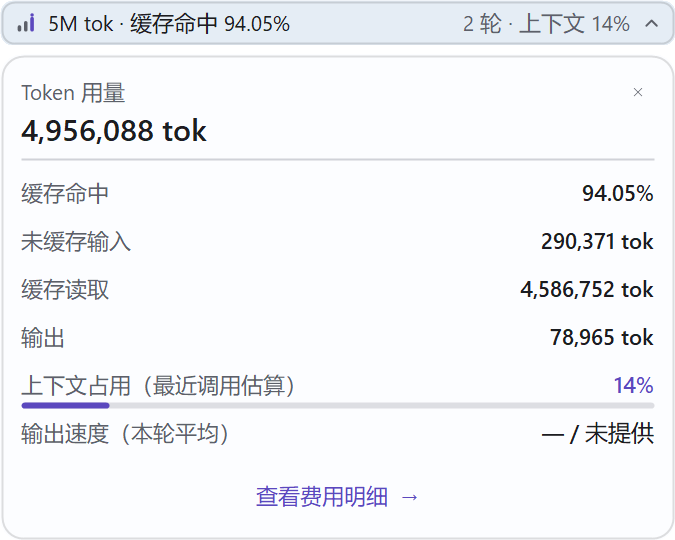
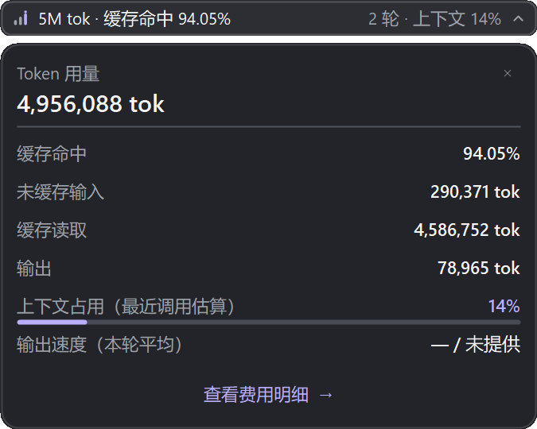
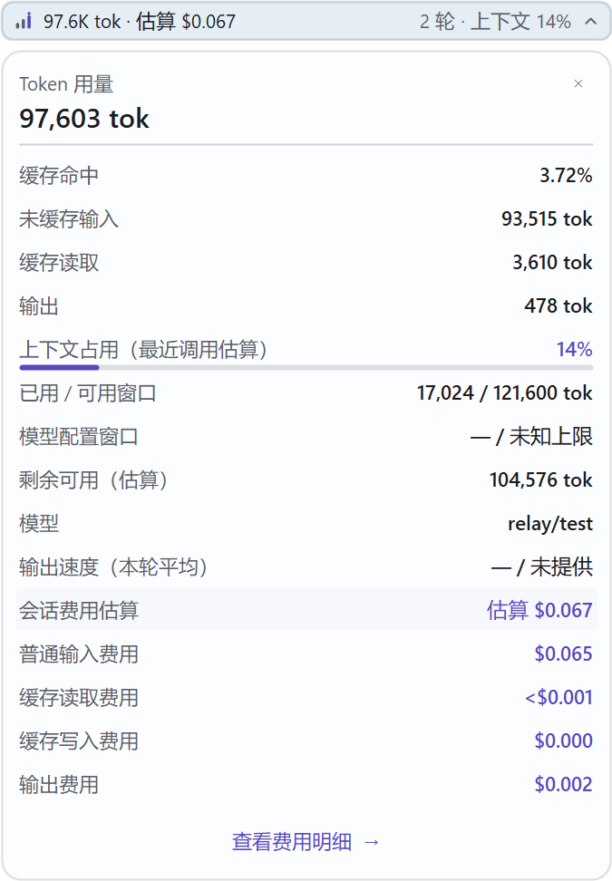
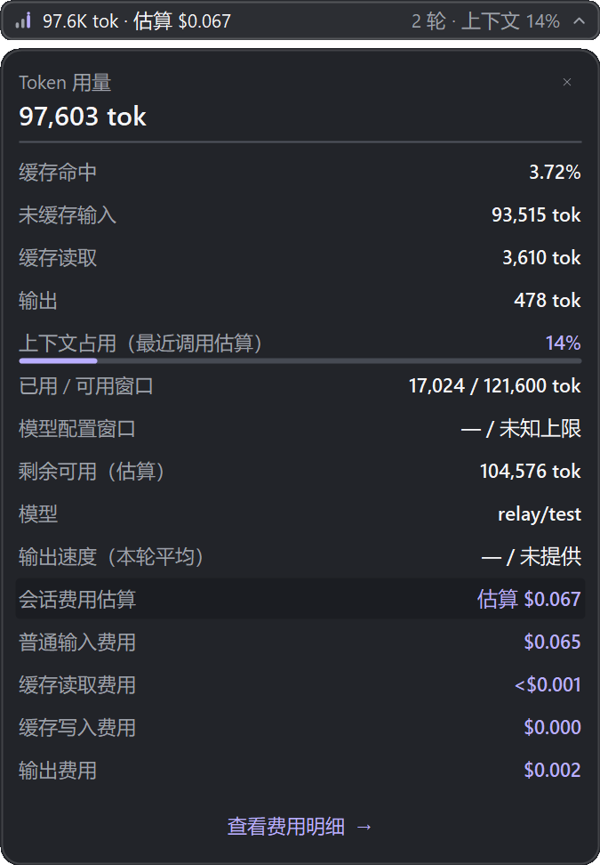

# Codex 用量助手 · Codex Usage Assistant

[](https://github.com/14866312/codex-relay-usage/releases/latest)
[](LICENSE)
[](#系统要求)
[](#系统要求)
[](README.zh-CN.md)

**Windows 上的 Codex 会话用量与费用悬浮条：直接读取 Codex 本地日志，无需 API 密钥。** 面向使用 API 中转站模型的 Codex Desktop 用户，实时显示当前会话的 Token、缓存命中、上下文占用，以及按个人配置估算的费用。



## 亮点

- **零配置、只读**：解析 Codex 本地日志与本地配置，不需要 API 密钥、代理或 ChatGPT 登录。
- **随调用更新**：对话进行中，每条调用报告到达即刷新，不必等整轮结束。
- **贴着 Codex 顶栏**：默认停在“文件／编辑／视图／帮助”右侧空白区，点击向下展开，跟随窗口移动与缩放。
- **同名对话也能认**：点“自动识别”读取当前页面的唯一会话 ID，同名、标题截断、侧栏隐藏都不影响。
- **费用可配置**：基础价乘倍率或直接折后价、可关闭的双档价格、精确模型别名绑定、分模型汇总、改价重算历史。
- **轻量原生**：WinForms / GDI+，不引入 UI 框架，没有常驻辅助进程。

## 下载与安装

1. 打开 [最新 Release](https://github.com/14866312/codex-relay-usage/releases/latest)，下载 `CodexRelayUsage-<版本>-win-x64.zip`。
2. 解压到任意目录，运行 `CodexRelayUsage.exe`；成品自带 .NET 10 运行时，无需安装 SDK。
3. 托盘勾选“开机启动”，或双击目录内的“设置开机自动启动.vbs”。

同一时间只运行一个实例，当前运行的 Codex 无需关闭。1.3.4 不再创建或改写桌面／开始菜单的 Codex 快捷方式；旧版写入的入口会在设置或取消时清理并还原备份。

## 界面

| 浅色 | 深色 |
| --- | --- |
|  |  |
|  |  |

石墨底紫色计量图标、浅深色圆角卡片、上下文进度条与统一按钮／输入框；托盘命令按“外观”和“会话与数据”归类，模型价格左右分栏，费用明细分“已计价／未计价”页签。悬浮条和卡片均有悬停、按下反馈，支持高 DPI 与小屏幕适配。更多实拍图见 [`previews/`](previews)。

## 系统要求

- Windows 10 / 11（x64）
- 自包含发布，无需预装 .NET 运行时；从源码构建需 [.NET 10 SDK](global.json)
- 可读取 Codex Desktop 本地日志（日志目录可在设置中更换）

## 常见问题

<details>
<summary>为什么有时要点两次“自动识别”？</summary>

1.3.3 起不再需要：识别在同一次点击内刷新当前页面，再调用 Codex 的“复制深度链接”（Ctrl+Alt+L）读取唯一会话 ID，并恢复原剪贴板内容。若该快捷键被改动或不支持，悬浮条会提示未提供链接；切换对话、超时或更换日志目录后，迟到结果不会建立绑定。
</details>

<details>
<summary>为什么刚启动 Codex 后所有页面短暂显示“当前页面尚未就绪”？</summary>

Codex 的无障碍树按需构建：构建完成前页面只暴露一个尚未填充的文档节点。1.3.7 起工具把这段等待单独标注为“当前页面尚未就绪”并持续自动重试，就绪后自动恢复识别与跟随，无需任何操作；旧版在这段时间会把每个页面都误报为“无法唯一识别当前页面”。本机实测：开机后首次启动 Codex 的等待可达 5–10 分钟（冷启动），同一登录会话内重启一次桌面端后约 2 秒就绪；等得太久时重启 Codex 桌面端通常能立刻恢复，工具会自动跟上。
</details>

<details>
<summary>费用为什么显示“未计价”或与账单不一致？</summary>

金额始终是按当前配置的**估算**。日志缺失或被上游改写的用量无法还原；未配置价格的模型归入“未计价”页签。金额统一显示三位小数，小额正数显示 `<$0.001`，内部计算保留完整精度。
</details>

<details>
<summary>会读取对话内容或上传数据吗？</summary>

不会。工具只读本地日志与本地配置，不联网上报；个人价格与设置不进入源码或发布包。
</details>

<details>
<summary>子代理和侧聊会一起统计吗？</summary>

悬浮条的 Token、缓存、上下文与速度仍然只反映当前会话，不合并其它线程。费用明细的“关联用量”页按显式关系列出同组的子代理与当前会话内的临时侧聊：每个成员只计入自身新增消耗（分叉继承的历史不会重复相加），只有累计数字、没有逐调用记录的成员不计入“已知合计”。归属只认显式关系，父关系冲突、缺失或成环的线程列为“未确认”。
</details>

## 构建与验证

```powershell
dotnet build .\src\CodexTokenOverlay\CodexTokenOverlay.csproj -c Release
dotnet publish .\src\CodexTokenOverlay\CodexTokenOverlay.csproj -c Release -r win-x64 --self-contained true -o .\artifacts\verify
.\scripts\Verify.ps1 -ExecutablePath .\artifacts\verify\CodexRelayUsage.exe
```

`*Tests.cs` 与合成自检会编译进发布的 EXE，`Verify.ps1` 校验的就是用户拿到的同一份二进制，请在交互式 Windows 桌面上执行。

## 文档

[中文使用说明](README.zh-CN.md) · [版本变更](CHANGELOG.md) · [验证记录](ACCEPTANCE.zh-CN.md) · [上游与许可](UPSTREAM.md)

[知识库索引](docs/README.md) · [术语表](CONTEXT.md)

## 许可

MIT，见 [LICENSE](LICENSE)。由 [codex-token-overlay](https://github.com/soleillevant0125/codex-token-overlay) 的 MIT 代码衍生，原版权与 .NET 许可均保留，见 [UPSTREAM.md](UPSTREAM.md)。
